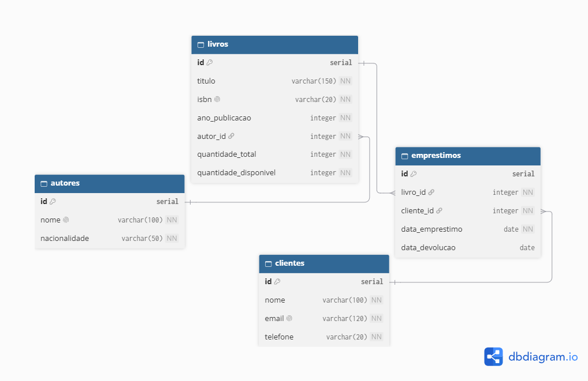

# 📚 BookStore Manager CLI

Sistema de gerenciamento de uma livraria executado via terminal (CLI), desenvolvido com **Node.js** e **TypeScript**, acompanhado do projeto do banco de dados relacional em **PostgreSQL**.

> Projeto Final Avaliativo, Módulo 01, Semana 13, Desenvolvedor(a) Back End Node, Turma 04.

## 📑 Sumário

- [Descrição](#-descrição)
- [Objetivo](#-objetivo)
- [Tecnologias utilizadas](#️-tecnologias-utilizadas)
- [Requisitos para execução](#-requisitos-para-execução)
- [Instalação](#-instalação)
- [Execução da aplicação](#️-execução-da-aplicação)
- [Banco de dados](#️-banco-de-dados)
- [Arquitetura do projeto](#️-arquitetura-do-projeto)
- [Funcionalidades implementadas](#️-funcionalidades-implementadas)
- [Estrutura de pastas](#-estrutura-de-pastas)
- [Exemplos de utilização](#-exemplos-de-utilização)
- [Versionamento](#-versionamento)
- [Integrantes da equipe](#-integrantes-da-equipe)
- [Kanban](#-kanban)
- [Vídeo de apresentação](#-vídeo-de-apresentação)

## 📖 Descrição

O **BookStore Manager CLI** informatiza o controle de uma pequena livraria, substituindo os registros manuais por uma aplicação de terminal com menus interativos. Ele permite administrar **autores**, **livros**, **clientes** e **empréstimos**, controlando também as devoluções e a disponibilidade dos exemplares.

O projeto tem duas partes independentes:

1. **Aplicação CLI** (Node.js e TypeScript): os dados ficam **em memória** durante a execução e são carregados por um seed ao iniciar. A aplicação **não se conecta** ao banco de dados.
2. **Projeto do banco de dados** (PostgreSQL): o Diagrama Entidade-Relacionamento (DER) e o arquivo `script.sql`, com a estrutura das tabelas, a manipulação de dados e os relatórios gerenciais em SQL.

Os dados iniciais da aplicação (`src/data/seed.ts`) são os mesmos dos comandos `INSERT` do `script.sql`.

## 🎯 Objetivo

Consolidar os conhecimentos do módulo, aplicando em um sistema de pequeno porte:

- JavaScript moderno, Node.js e TypeScript;
- Programação Orientada a Objetos, interfaces, classes e tipagem estática;
- Programação assíncrona com Promises e `async/await`;
- Arquitetura em camadas e separação de responsabilidades;
- Modelagem de banco relacional e comandos SQL (DDL, DML e consultas com `JOIN`, `GROUP BY`, `ORDER BY`, `LIMIT` e funções de agregação);
- Princípios de Clean Code e SOLID;
- Git, GitHub e GitFlow.

## 🛠️ Tecnologias utilizadas

| Tecnologia | Uso |
|---|---|
| Node.js | Ambiente de execução |
| TypeScript | Linguagem, com tipagem estática (modo `strict`) |
| tsx | Execução dos arquivos `.ts` em desenvolvimento |
| `readline/promises` (nativo do Node.js) | Leitura de dados digitados no terminal |
| PostgreSQL 14 | Banco de dados relacional |
| pgAdmin 4 | Execução do `script.sql` e conferência das tabelas |
| dbdiagram.io | Elaboração do DER |
| Git e GitHub | Versionamento e hospedagem do código |

A aplicação não usa bibliotecas externas em tempo de execução. As dependências são apenas de desenvolvimento (`typescript`, `tsx` e `@types/node`).

## ✅ Requisitos para execução

- [Node.js](https://nodejs.org) versão **20 ou superior** (inclui o npm);
- [Git](https://git-scm.com);
- [PostgreSQL](https://www.postgresql.org) versão **14 ou superior** e o pgAdmin 4, apenas para executar o banco de dados.

Confira as versões instaladas:

```bash
node -v
npm -v
git --version
```

## 📥 Instalação

```bash
git clone https://github.com/marcelodukeves/bookstore-manager-cli.git
cd bookstore-manager-cli
npm install
```

O código completo e estável está na branch `main`.

## ▶️ Execução da aplicação

| Comando | O que faz |
|---|---|
| `npm run dev` | Executa a aplicação em modo de desenvolvimento (TypeScript direto) |
| `npm run build` | Compila o projeto para JavaScript na pasta `dist/` |
| `npm start` | Executa a versão compilada (rode `npm run build` antes) |

Para iniciar:

```bash
npm run dev
```

Ao abrir, a aplicação carrega os dados iniciais (6 autores, 7 livros, 5 clientes e 6 empréstimos) e mostra o menu principal. Como os dados ficam em memória, **ao fechar a aplicação eles voltam ao estado inicial** na próxima execução.

## 🗄️ Banco de dados

O projeto do banco está na pasta `database/`:

| Arquivo | Descrição |
|---|---|
| `der-bookstore.png` | Diagrama Entidade-Relacionamento (DER) |
| `der-bookstore.dbml` | Código-fonte do DER (dbdiagram.io) |
| `script.sql` | Estrutura (DDL), manipulação de dados (DML) e relatórios |

### Diagrama Entidade-Relacionamento (DER)



**Relacionamentos:**

| Relacionamento | Cardinalidade |
|---|---|
| `autores` → `livros` | 1:N (um autor tem vários livros; cada livro tem um autor) |
| `livros` → `emprestimos` | 1:N (um livro pode ter vários empréstimos) |
| `clientes` → `emprestimos` | 1:N (um cliente pode ter vários empréstimos) |

A tabela `emprestimos` liga livros e clientes. Enquanto `data_devolucao` é nula, o empréstimo está **ativo**.

### Como executar o `script.sql` no PostgreSQL

**Opção 1: pgAdmin 4**

1. Conecte-se ao servidor PostgreSQL.
2. Clique com o botão direito em **Databases**, depois **Create → Database...**, digite `bookstore_manager` e clique em **Save**.
3. Clique com o botão direito em `bookstore_manager` e abra o **Query Tool**.
4. Confira no topo da aba se a conexão é `bookstore_manager/postgres@PostgreSQL`.
5. Clique no ícone de pasta (**Open File**), escolha `database/script.sql` e confirme.
6. Execute com o botão de **play** (ou `F5`). Deve aparecer `Query returned successfully`.

**Opção 2: linha de comando (`psql`)**

```bash
psql -U postgres -c "CREATE DATABASE bookstore_manager;"
psql -U postgres -d bookstore_manager -f database/script.sql
```

> O script **recria as tabelas do zero** a cada execução (`DROP TABLE IF EXISTS`), então pode ser executado várias vezes. Os acentos aparecem corretamente quando o arquivo é lido em **UTF-8**.

### Organização do `script.sql`

1. **Criação da estrutura (DDL):** tabelas `autores`, `clientes`, `livros` e `emprestimos`, com chaves primárias (`SERIAL`), chaves estrangeiras e as restrições `NOT NULL`, `UNIQUE` e `CHECK`.
2. **Manipulação de dados (DML):** `INSERT` com os dados do seed, exemplos de `UPDATE` e `DELETE` (respeitando os relacionamentos) e `SELECT` de conferência.
3. **Relatórios:** consultas com `INNER JOIN`, `LEFT JOIN`, `GROUP BY`, `ORDER BY`, `LIMIT` e funções de agregação.

### Relatórios em SQL

| Relatório | Recursos principais |
|---|---|
| Livros disponíveis | `INNER JOIN`, `WHERE`, `ORDER BY` |
| Livros emprestados | `INNER JOIN` em três tabelas |
| Livros cadastrados por autor | `LEFT JOIN`, `GROUP BY`, `COUNT`, `SUM` |
| Quantidade de empréstimos por livro | `LEFT JOIN`, `GROUP BY`, `COUNT` |
| Clientes com empréstimos ativos | `INNER JOIN`, `GROUP BY`, `COUNT` |
| Extra: 3 livros mais emprestados | `GROUP BY`, `ORDER BY`, `LIMIT` |

Para ver um relatório separadamente no pgAdmin, selecione o texto da consulta e execute somente a seleção.

## 🏗️ Arquitetura do projeto

A aplicação é organizada em camadas, cada uma com responsabilidade bem definida e baixo acoplamento:

```
Main → Menus → Controllers → Services → Repositories → Dados em memória
                                 ↑
                              Models / Utils
```

| Camada | Responsabilidade |
|---|---|
| **Main** (`main.ts`) | Monta as camadas, carrega o seed e inicia o menu principal |
| **Menus** | Organizam a navegação, exibem as opções e tratam opções inválidas |
| **Controllers** | Interagem com o usuário no terminal e acionam os services |
| **Services** | Implementam as regras de negócio e as validações |
| **Repositories** | Únicos responsáveis por guardar e recuperar os dados em memória (`Map`) |
| **Models** | Interfaces, tipos e classes das entidades |
| **Utils** | Funções reutilizáveis: validações, formatação, leitura do terminal e erro de negócio |
| **Database** | DER e `script.sql` (fora de `src/`, sem conexão com a aplicação) |

**Decisões técnicas:**

- **Injeção de dependência pelo construtor:** cada classe recebe o que precisa, e o `main.ts` monta o conjunto.
- **Métodos `async`** em services e repositories, preparando a aplicação para uma futura integração com o banco.
- **`ErroDeNegocio`:** erro personalizado lançado pelos services; os menus o capturam e mostram uma mensagem clara sem interromper a aplicação.
- **Ids sequenciais** nos repositories, no mesmo comportamento do `SERIAL` do PostgreSQL, o que mantém o seed igual aos `INSERT` do `script.sql`.
- **Empréstimos não são apagados:** a devolução só preenche a data, preservando o histórico para os relatórios.

## ⚙️ Funcionalidades implementadas

**Menu principal:** Autores, Livros, Clientes, Empréstimos e Encerrar aplicação.

| Módulo | Operações |
|---|---|
| **Autores** | Cadastrar, listar, consultar por ID, atualizar e remover |
| **Livros** | Cadastrar (vinculado a um autor existente), listar, consultar, atualizar e remover |
| **Clientes** | Cadastrar, listar, consultar por ID, atualizar e remover |
| **Empréstimos** | Registrar empréstimo, registrar devolução, listar todos e listar ativos (com livro, cliente e data) |

### Regras de negócio e validações

| Situação | Comportamento |
|---|---|
| Campo obrigatório vazio | Mensagem de erro |
| ID inválido (texto, zero ou negativo) | Mensagem de erro |
| E-mail inválido | Mensagem de erro; o e-mail é guardado em minúsculas |
| Ano de publicação fora do intervalo (1000 até o ano atual) | Mensagem de erro |
| Autor, livro, cliente ou empréstimo inexistente | Mensagem de erro |
| Autor com nome duplicado | Bloqueado |
| Livro com ISBN duplicado | Bloqueado |
| Cliente com e-mail duplicado | Bloqueado |
| Livro vinculado a autor inexistente | Bloqueado |
| Livro sem exemplares disponíveis | Empréstimo bloqueado |
| Cliente com empréstimo ativo do mesmo livro | Novo empréstimo bloqueado |
| Devolução de empréstimo já devolvido | Bloqueada |
| Remover autor que possui livros | Bloqueado |
| Remover livro ou cliente que possui empréstimos | Bloqueado |
| Reduzir a quantidade total abaixo dos exemplares emprestados | Bloqueado |

Todos os erros aparecem como mensagens claras e a aplicação continua em execução.

## 📂 Estrutura de pastas

```
bookstore-manager-cli/
├── database/
│   ├── der-bookstore.dbml
│   ├── der-bookstore.png
│   └── script.sql
├── src/
│   ├── controllers/
│   │   ├── AutorController.ts
│   │   ├── ClienteController.ts
│   │   ├── EmprestimoController.ts
│   │   └── LivroController.ts
│   ├── data/
│   │   └── seed.ts
│   ├── menus/
│   │   ├── Menu.ts
│   │   ├── menuAutores.ts
│   │   ├── menuClientes.ts
│   │   ├── menuEmprestimos.ts
│   │   ├── menuLivros.ts
│   │   └── menuPrincipal.ts
│   ├── models/
│   │   ├── Autor.ts
│   │   ├── Cliente.ts
│   │   ├── Emprestimo.ts
│   │   └── Livro.ts
│   ├── repositories/
│   │   ├── AutorRepository.ts
│   │   ├── ClienteRepository.ts
│   │   ├── EmprestimoRepository.ts
│   │   └── LivroRepository.ts
│   ├── services/
│   │   ├── AutorService.ts
│   │   ├── ClienteService.ts
│   │   ├── EmprestimoService.ts
│   │   └── LivroService.ts
│   ├── utils/
│   │   ├── ErroDeNegocio.ts
│   │   ├── formatadores.ts
│   │   ├── leitorTerminal.ts
│   │   └── validacoes.ts
│   └── main.ts
├── .gitignore
├── package.json
├── README.md
└── tsconfig.json
```

## 💡 Exemplos de utilização

### Menu principal

```
--------------------------------------------------
  📚 BookStore Manager CLI - Menu Principal
--------------------------------------------------
  1 - Autores
  2 - Livros
  3 - Clientes
  4 - Empréstimos
  0 - Encerrar aplicação
--------------------------------------------------
Escolha uma opção:
```

### Registrar um empréstimo

1. Digite `4` (Empréstimos) e depois `1` (Registrar empréstimo).
2. A aplicação lista os livros e os clientes cadastrados.
3. Informe o ID do livro e o ID do cliente.

```
✅ Empréstimo registrado: [7] Livro ID: 2 | Cliente ID: 1 | Empréstimo: 27/10/2026 | Ativo
```

### Tentar emprestar um livro sem exemplares

Com os dados iniciais, o livro `6` (A Revolução dos Bichos) tem um único exemplar, que já está emprestado:

```
⚠️  O livro "A Revolução dos Bichos" não possui exemplares disponíveis no momento.
```

### Tentar remover um autor com livros

```
⚠️  Não é possível remover "Machado de Assis": o autor possui 2 livro(s) cadastrado(s).
```

### Consultar um registro inexistente

```
⚠️  Cliente com id 99 não encontrado.
```

### Registrar uma devolução

1. No menu de Empréstimos, digite `2` (Registrar devolução).
2. A aplicação lista os empréstimos ativos.
3. Informe o ID do empréstimo. O exemplar volta ao estoque do livro.

## 🔀 Versionamento

O projeto segue o fluxo GitFlow simplificado, com commits semânticos (`feat`, `fix`, `docs`, `chore`, `refactor`, `style`).

| Branch | Finalidade |
|---|---|
| `main` | Versão final e estável |
| `develop` | Integração das funcionalidades |
| `feat/autores` | Módulo de autores |
| `feat/livros` | Módulo de livros |
| `feat/clientes` | Módulo de clientes |
| `feat/emprestimos` | Módulo de empréstimos e devoluções |
| `feat/banco-dados` | DER e `script.sql` |
| `docs/readme` | Documentação |

## 👥 Integrantes da equipe

| Nome | GitHub |
|---|---|
| Marcelo Dukeveis | [@marcelodukeves](https://github.com/marcelodukeves) |

## 📋 Kanban

Acompanhe o planejamento e a evolução das tarefas no quadro do projeto: [Kanban do BookStore Manager CLI](https://github.com/users/marcelodukeves/projects/3)

## 🎥 Vídeo de apresentação

[Assistir ao vídeo de apresentação no YouTube](https://www.youtube.com/watch?v=EwZHVL3fM54)